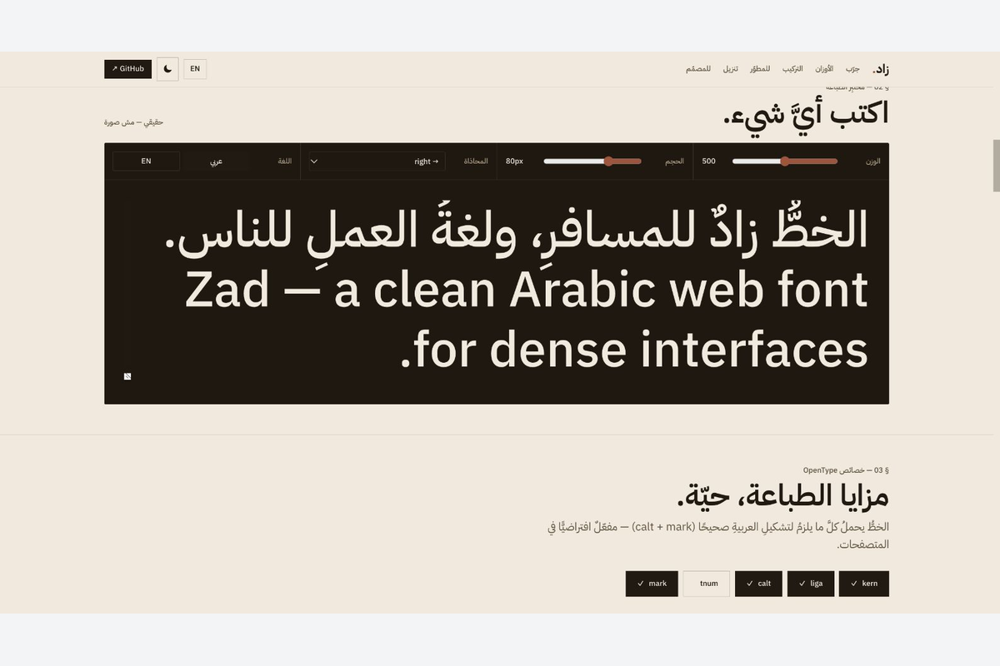
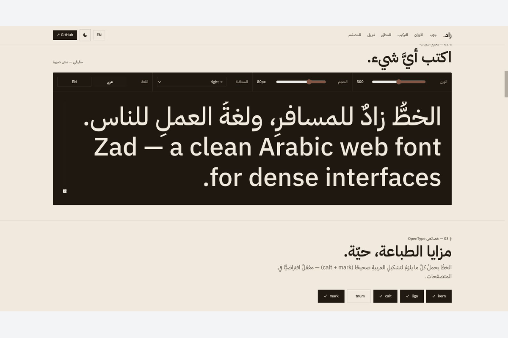

<div align="center">

<picture>
  <source media="(prefers-color-scheme: dark)" srcset="assets/readme/hero-dark.svg">
  
</picture>

<p>
  <a href="LICENSE"></a>
  <a href="https://github.com/zadstack/zad-font/tree/v1.0.1"></a>
  <a href="https://www.jsdelivr.com/package/gh/zadstack/zad-font"></a>
  <a href="https://zadstack.github.io/zad-font/"></a>
  <a href="https://github.com/zadstack/zad-font/stargazers"></a>
</p>

**[Live site](https://zadstack.github.io/zad-font/)** · **[Quick start](#quick-start--البداية-السريعة)** · **[Weights](#weights--الأوزان)** · **[MCP server](#mcp-server--للـai-agents)** · **[License](#license--الرخصة)**

</div>

<div dir="rtl">

**زاد** خط عربي نضيف ومفتوح المصدر للويب: نسخة خفيفة ومُعاد تسميتها من **IBM Plex Sans Arabic**، بخمس أوزان، بصيغتي `woff2` و`ttf`، تحت رخصة SIL OFL 1.1. سطر CSS واحد وتبدأ، من غير أي اعتماديات.

</div>

**Zad** is a clean, open-source Arabic web font: a renamed, subset derivative of **IBM Plex Sans Arabic** with 5 weights, `woff2` + `ttf`, under the SIL Open Font License 1.1. One CSS line, zero dependencies.

---


## Application preview





Captured locally on 24 October 2026 from the shipped font tester: replacing the example with a new Arabic sentence. The type is rendered by the actual font files.

[Media provenance](docs/media/README.md)

## Quick start — البداية السريعة

```html
<link rel="preconnect" href="https://cdn.jsdelivr.net" crossorigin>
<link rel="stylesheet" href="https://cdn.jsdelivr.net/gh/zadstack/zad-font@1.0.1/zad.css">
```

```css
body { font-family: var(--font-zad); }   /* or: 'Zad', sans-serif */
```

`zad.css` loads all 5 weights (`font-display: swap`) through relative paths, so jsDelivr serves the `woff2` files from the same
release. It also defines `--font-zad` with a safe fallback stack:
`"Zad", "Segoe UI", system-ui, -apple-system, "Helvetica Neue", Arial, "Noto Sans Arabic", sans-serif`.

---

## Weights — الأوزان

<picture>
  <source media="(prefers-color-scheme: dark)" srcset="assets/readme/weights-dark.svg">
  
</picture>

| الوزن · Weight | `font-weight` | Glyphs | `woff2` | `ttf` | CDN (`woff2`) |
|---|:---:|:---:|---:|---:|---|
| Light | 300 | 1,657 | 70.1 KB | 216.8 KB | [`Zad-Light.woff2`](https://cdn.jsdelivr.net/gh/zadstack/zad-font@1.0.1/fonts/Zad-Light.woff2) |
| Regular | 400 | 1,657 | 66.6 KB | 214.7 KB | [`Zad-Regular.woff2`](https://cdn.jsdelivr.net/gh/zadstack/zad-font@1.0.1/fonts/Zad-Regular.woff2) |
| Medium | 500 | 1,652 | 70.2 KB | 219.8 KB | [`Zad-Medium.woff2`](https://cdn.jsdelivr.net/gh/zadstack/zad-font@1.0.1/fonts/Zad-Medium.woff2) |
| SemiBold | 600 | 1,652 | 70.8 KB | 222.0 KB | [`Zad-SemiBold.woff2`](https://cdn.jsdelivr.net/gh/zadstack/zad-font@1.0.1/fonts/Zad-SemiBold.woff2) |
| Bold | 700 | 1,652 | 68.2 KB | 223.9 KB | [`Zad-Bold.woff2`](https://cdn.jsdelivr.net/gh/zadstack/zad-font@1.0.1/fonts/Zad-Bold.woff2) |

(`.ttf` على نفس المسار · same path with `.ttf` for desktop and design apps.)

---

## Features — المميزات

<picture>
  <source media="(prefers-color-scheme: dark)" srcset="assets/readme/forms-dark.svg">
  
</picture>

- **Arabic + Latin + digits (Arabic and Latin) + punctuation:** عربي ولاتيني وأرقام وعلامات ترقيم.
- **Correct joining and marks:** الوصل والتشكيل سليمين، ومتحقَّق منهم بـ HarfBuzz (نفس محرك المتصفحات).
- **Zero dependencies:** ملف CSS + فولدر خطوط، يشتغل في أي مكان.
- **Reproducible build:** نفس البايتات في كل بناء، ومواضع التشكيل (GPOS) مطابقة للأصل.
- **Self-host or CDN:** ارفع الملفات بنفسك أو استخدم jsDelivr.

---

## Install — التركيب

### Option A · Self-host (recommended)

انسخ فولدر `zad-font/` كامل (المهم: `fonts/` + `zad.css`)، وضيف في الـ`<head>`:

```html
<link rel="stylesheet" href="zad-font/zad.css">
```

```css
body { font-family: 'Zad', sans-serif; }   /* أو: var(--font-zad) */
h1 { font-weight: 700; }     /* Bold     */
.lead { font-weight: 600; }  /* SemiBold */
.label { font-weight: 500; } /* Medium   */
p { font-weight: 400; }      /* Regular  */
.faint { font-weight: 300; } /* Light    */
```

### Option B · CDN (jsDelivr)

<details>
<summary><b>Which ref? · أختار أنهي ref؟</b> — and a hand-written <code>@font-face</code></summary>

| Ref | URL | |
|---|---|---|
| **Release `1.0.1`** (recommended) | `https://cdn.jsdelivr.net/gh/zadstack/zad-font@1.0.1/zad.css` | ثابت · never changes |
| Commit `3966299` | `https://cdn.jsdelivr.net/gh/zadstack/zad-font@3966299/zad.css` | ثابت · same font files as 1.0.1 |
| `@main` | `https://cdn.jsdelivr.net/gh/zadstack/zad-font@main/zad.css` | آخر نسخة على `main`، ممكن تتأخر لحد 12 ساعة · cached up to 12 h, can change |
| `@latest` | `https://cdn.jsdelivr.net/gh/zadstack/zad-font@latest/zad.css` | آخر tag (حالياً 1.0.1) · newest tag, currently 1.0.1 |

Only the weights you use (لو عايز وزن أو اتنين بس):

```css
@font-face {
  font-family: "Zad";
  font-weight: 400;
  font-style: normal;
  font-display: swap;
  src: url("https://cdn.jsdelivr.net/gh/zadstack/zad-font@1.0.1/fonts/Zad-Regular.woff2") format("woff2");
}
@font-face {
  font-family: "Zad";
  font-weight: 700;
  font-style: normal;
  font-display: swap;
  src: url("https://cdn.jsdelivr.net/gh/zadstack/zad-font@1.0.1/fonts/Zad-Bold.woff2") format("woff2");
}
```

</details>

### Option C · Tailwind

```js
// tailwind.config
theme: { extend: { fontFamily: { zad: ['Zad', 'sans-serif'] } } }
```

```html
<body class="font-zad">…</body>
```

---

## MCP server — للـAI agents

A live **MCP server** lets AI agents (Cursor, Claude, VS Code…) read Zad's metadata, get install snippets, preview text and
**generate derived fonts** from open-source (OFL) sources.
فيه MCP server أونلاين بيخلّي أي AI agent يعرف كل حاجة عن زاد، ويطلّع كود التركيب، ويعمل preview، ويولّد خطوط مشتقة.

- **URL:** `https://fekra-zad-font.marsaplatform.com/mcp` (Streamable HTTP · no auth · **19 tools**)
- **Project page:** https://spaces.marsaplatform.com/s/sp2rdwbuyb/

```json
{ "mcpServers": { "zad-font": { "url": "https://fekra-zad-font.marsaplatform.com/mcp" } } }
```

<details>
<summary><b>The 19 tools · الأدوات</b> and the <code>npx mcp-remote</code> config for stdio-only clients</summary>

| Group | Tools |
|---|---|
| Zad font (6) | `get_font_info` · `get_install_snippet` · `get_font_files` · `get_css` · `check_text_support` · `preview_text` |
| Derived fonts (5) | `list_source_fonts` · `generate_font` · `get_generated_font` · `preview_generated_font` · `get_font_css` |
| Pins (3) | `pin_generated_font` · `unpin_generated_font` · `list_pinned_fonts` |
| Presets (4) | `save_preset` · `list_presets` · `load_preset` · `delete_preset` |
| Usage (1) | `get_font_usage` |

```json
{
  "mcpServers": {
    "zad-font": {
      "command": "npx",
      "args": ["-y", "mcp-remote", "https://fekra-zad-font.marsaplatform.com/mcp"]
    }
  }
}
```

> الخطوط اللي بتتولّد **مشتقة** تحت SIL OFL 1.1، ومينفعش تستخدم الـReserved Font Name بتاع المصدر.
> Generated fonts are **OFL derivatives** and must not use a source's Reserved Font Name.

</details>

---

## For contributors — للمطورين

<details>
<summary><b>محتويات الفولدر · Repository layout</b></summary>

```
zad-font/
├── index.html        ← اللاندنج بيج (GitHub Pages)
├── zad.css           ← @font-face للأوزان الخمسة (font-display: swap)
├── fonts/
│   ├── Zad-Light.woff2     + Zad-Light.ttf
│   ├── Zad-Regular.woff2   + Zad-Regular.ttf
│   ├── Zad-Medium.woff2    + Zad-Medium.ttf
│   ├── Zad-SemiBold.woff2  + Zad-SemiBold.ttf
│   └── Zad-Bold.woff2      + Zad-Bold.ttf
├── proof/
│   ├── specimen-proof.png  ← proof مولّد من الخطوط نفسها
│   └── specimen-proof.svg
├── build.py          ← السكربت اللي بنى الكِت
├── tools/            ← compare_builds.py، readme_assets.py
├── OFL.txt / LICENSE ← الرخصة (لازمة تفضل مع الفونت)
├── FONTLOG.txt       ← سجل التغييرات
├── QA-REPORT.md      ← تقرير فحص FontBakery
├── qa.json           ← نتيجة FontBakery (machine-readable)
├── originality.json  ← بيان الاشتقاق من IBM Plex Sans Arabic
├── README.md
├── assets/readme/    ← رسومات الـREADME (SVG، مولّدة من الخط نفسه)
└── _src/             ← الأصل (مش محتاجها للويب — للبناء فقط)
    └── IBMPlexSansArabic-*.ttf
```

</details>

<details>
<summary><b>إعادة البناء · Reproducible build</b></summary>

فولدر `_src/` فيه ملفات IBM Plex Sans Arabic الأصلية (النسخة الرسمية من Google
Fonts تحت OFL). يعني `python build.py` بيشتغل على طول ويطلّع **`fonts/*.ttf`
و`fonts/*.woff2`** مع بعض من نفس الـsubset (متّسقين تماماً، نفس البايتات في كل
بناء).

```bash
# مطلوب مرة واحدة:
pip install fonttools brotli

python build.py        # يبني fonts/*.ttf + fonts/*.woff2 من _src/
```

عايز تضيف وزن جديد أو تشيل وزن؟ عدّل `WEIGHTS` في [`build.py`](build.py).
لإضافة وزن، نزّل ملف الـttf المقابل من Google Fonts
(`ofl/ibmplexsansarabic/IBMPlexSansArabic-<Weight>.ttf`) إلى `_src/`.

README artwork: `python tools/readme_assets.py` (fontTools + uharfbuzz) rebuilds `assets/readme/*.svg` from `fonts/*.ttf`.
Text is shaped with HarfBuzz and stored as outlines, because GitHub doesn't load web fonts inside SVG images.

</details>

<details>
<summary><b>فحص الجودة · QA (FontBakery: 0 FATAL · 10 FAIL inherited)</b></summary>

تقرير FontBakery الكامل في [`QA-REPORT.md`](QA-REPORT.md):

FontBakery 1.1.0 · profile `universal` · الأوزان الخمسة:

| Target    | FATAL | FAIL | WARN | PASS |
| --------- | :---: | :--: | :--: | :--: |
| 5 weights |   0   |  10  |  30  | 360  |

- **الـ10 FAIL** = فحصين × 5 أوزان، **متوارثين من IBM Plex Sans Arabic** ومحتاجين تعديل في التصميم نفسه:
  `arabic_spacing_symbols` (رموز U+FBB2–FBC1 مرسومة بعرض صفر) · `case_mapping` (Đ من غير đ، وĵ من غير Ĵ).
- **الـ30 WARN** = 6 فحوصات × 5 أوزان، متوارثة برضه (GDEF، ligature carets، أسماء الجليفات…).
- اتصلّح في `build.py`: `smart_dropout` (إضافة smart dropout control لجدول `prep`)، و`underline_thickness` (توحيد قيم الـunderline)، و`no_mac_entries`.
- اتأكدنا إن الرسم والتشكيل ماتغيّروش: نفس hashes لكل الجليفات ونفس نتيجة HarfBuzz لـ4,814 نص × 4 إعدادات × 5 أوزان (`tools/compare_builds.py`).
- الوصل والتشكيل اتحقق منهم بـ HarfBuzz (نفس محرك المتصفحات) — مفيش أي FAIL بيأثر على التشكيل.

> The 10 remaining FAILs and 30 WARNs are inherited from upstream IBM Plex Sans Arabic
> outlines/GDEF; fixing them would require design changes (new advance widths or new glyphs).
> `smart_dropout` (5 FAILs) was fixed in `build.py` without touching outlines or shaping. Older docs claiming
> "0 FAIL" referred to an earlier 3-weight `check-opentype` run.

</details>

### ملاحظات · Notes

- **الفونت نفسه (`fonts/` + `zad.css`) صفر اعتماديات**: لا JS ولا build.
- **`index.html` (الموقع على GitHub Pages) بيستخدم Tailwind Play CDN + Alpine.js** للعرض بس؛ مش جزء من اللي بتنشره.

---

## License — الرخصة

Zad مبني على **IBM Plex Sans Arabic** © IBM Corp.، تحت **SIL Open Font License 1.1**.
ده **مسموح قانونياً** بشرط:

1. ✅ الاسم الجديد **ميحتويش** الاسم المحجوز `"Plex"` — و"Zad" مالهوش علاقة بيه.
2. ✅ تشحن `OFL.txt` (أو `LICENSE`) مع الفونت — موجود.
3. ✅ الفونت المعدَّل يفضل تحت OFL.
4. ❌ ممنوع تبيع الفونت لوحده.

تقدر تستخدمه في أي عدد مواقع — شخصية أو تجارية — مجاناً.

> Zad is a renamed/subset derivative of [IBM Plex Sans Arabic](https://github.com/IBM/plex),
> distributed under the [SIL Open Font License 1.1](LICENSE). It does **not** use
> the Reserved Font Name "Plex". You may use it in any number of websites —
> personal or commercial — free of charge.

**حامل حقوق النسخة المعدّلة / Maintainer of this derivative:** Ahmed Morsy ([@ahmedvnabil](https://github.com/ahmedvnabil)).

## Credits

- Source: [IBM Plex Sans Arabic](https://github.com/IBM/plex) © IBM Corp. (SIL OFL 1.1)
- Tooling: [fontTools](https://github.com/fonttools/fonttools), [Brotli](https://github.com/google/brotli), [HarfBuzz](https://github.com/harfbuzz/harfbuzz)
- QA: [FontBakery](https://github.com/fonttools/fontbakery)
